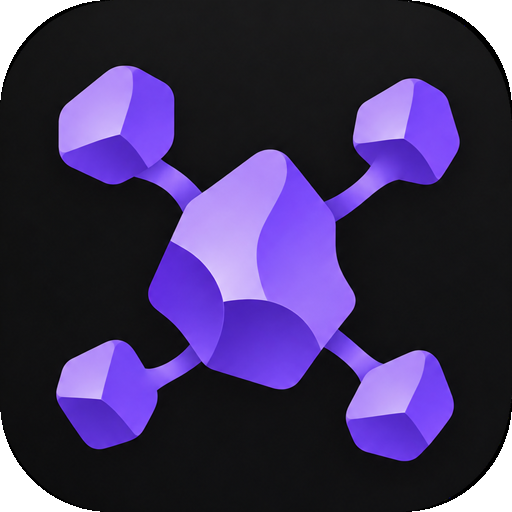
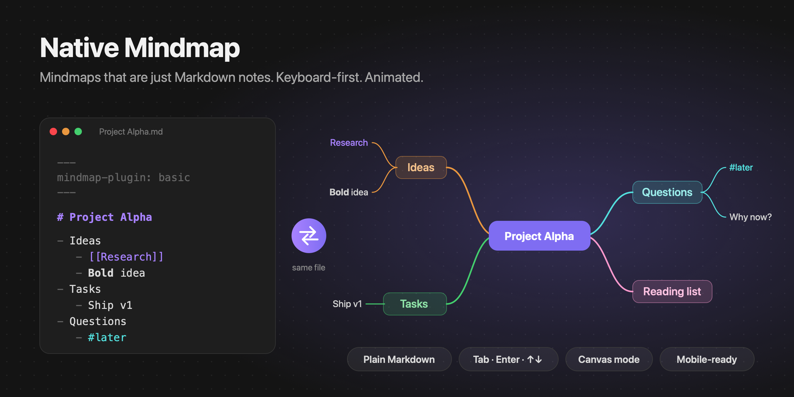
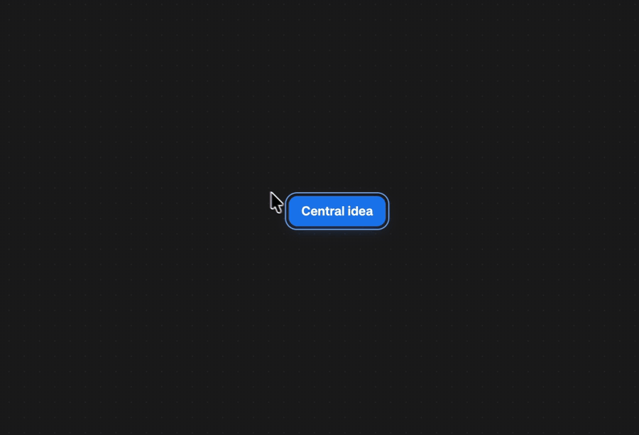

<div align="center">



# Native Mindmap

**Mindmaps that are just Markdown notes. Keyboard-first. Animated.**

[](LICENSE)




<!-- Replace with the real demo once recorded: assets/demo.gif (or an mp4 dragged into a GitHub issue to get a hosted URL) -->
<!--  -->

[Install](#installation) · [Features](#features) · [Shortcuts](#shortcuts) · [Canvas mode](#canvas-mode)

</div>

---

## Why Native Mindmap?

Most mindmap tools make you choose: a beautiful editor that locks your ideas in a proprietary format, or plain text that you can't see the shape of. **Native Mindmap refuses the trade-off.**

- **Your map *is* a note.** A mindmap is a regular Markdown file: the first `# heading` is the central topic and the nested bullet list is the tree. It stays searchable, linkable, diffable, syncable and future-proof. No database, no lock-in, no export step.
- **Keyboard-first.** `Tab` adds a child, `Enter` adds a sibling, arrows navigate. You can build a whole map without touching the mouse.
- **Alive.** Topics grow out of their parent, fold back into it, and edges morph smoothly as the layout changes. Animations respect your system's *reduce motion* setting.
- **Truly native.** Topics render real Obsidian Markdown: `[[wikilinks]]` with hover preview, tags, **bold**, `code`, math. It follows your theme's palette in light and dark mode.
- **Works inside Canvas.** Turn any Canvas card into the center of a mindmap with a single keypress.

## At a glance

| | Native Mindmap |
| --- | --- |
| Storage | A plain `.md` note: heading + bullet list. No JSON, no database. |
| Editing | Directly on the map, with the keyboard (`Tab`, `Enter`, arrows) or the mouse. |
| Rendering | Real Obsidian Markdown: wikilinks with hover preview, tags, bold, code, math. |
| Layouts | Mindmap, Logic, Timeline, switchable per map with animation. |
| Canvas | Turn any Canvas card into a mindmap with `Tab`. |
| Platforms | Desktop, tablet, phone. |

## Quick start

A mindmap is a note with one frontmatter flag:

```markdown
---
mindmap-plugin: basic
---

# Project Alpha

- Ideas
	- [[Some note]]
	- **Bold** idea
- Tasks
	- Ship v1
```

The note opens as a mindmap wherever Obsidian opens it: file explorer, links, quick switcher. Switch to the raw Markdown and back from the tab header, the "More options" menu or the command palette.

## Features

- **Smooth animations** on add, delete, fold, move and layout change.
- **Balanced branches** on both sides, colored from your theme's palette.
- **Drag and drop** to reparent a topic (drop on it) or reorder (drop above or below).
- **Multi-select** with a drag rectangle, `Shift` click or `Mod A`, then delete, copy, fold or drag topics together.
- **Undo / redo**, plus copy / cut / paste as Markdown lists (paste a list from anywhere to grow a branch instantly).
- **Fold and unfold** branches, with a count of hidden topics.
- **Canvas-like navigation**: pan, zoom, pinch, dot grid, floating zoom controls, zoom to fit / selection.
- **Three layouts**, selectable per map.
- **Mobile and tablet** friendly.
- **Configurable**: spacing, topic width, colors, grid, animation speed, scroll behavior, default layout and folder for new maps.
- Every action is a **command**, so you can bind your own hotkeys.

## Layouts

Each map picks its own layout from the layout button (Markdown view) or the right-click menu (Canvas):

| Layout | Description |
| --- | --- |
| **Mindmap** | Branches balanced on both sides of the central topic. |
| **Logic** | Everything grows to the right, like a logic chart. |
| **Timeline** | First-level topics are chained along an axis; their details hang alternately below and above. |

## Canvas mode

Inside any Obsidian Canvas, select a card and press `Tab`: it becomes the center of a mindmap and gets a connected child. `Enter` adds a sibling, arrows move between topics, `Delete` removes a branch, and the right-click menu switches layout or tidies the map.

Several mindmaps can live on the same canvas next to your other cards. Only edges created by the plugin (marked `"mindmap": true` in the `.canvas` file) are ever re-arranged; the rest of your canvas is left alone.

> Canvas mode relies on Canvas internals (checked on Obsidian 1.14) and may need an update after a future Obsidian release. You can turn it off in the settings.

## Shortcuts

| Key | Action |
| --- | --- |
| `Tab` | Add child |
| `Enter` / `Shift Enter` | Add sibling below / above |
| `Space`, `F2`, double-click | Edit topic |
| `Delete` / `Backspace` | Delete topic |
| Arrows | Navigate |
| Drag empty space / `Shift` click / `Mod A` | Select several topics |
| Scroll, `Space` + drag, middle mouse | Pan |
| `Mod` + scroll | Zoom |
| `Alt ↑ / ↓` | Reorder |
| `Shift Tab` | Move up one level |
| `Esc` / `Home` | Clear selection / select central topic |
| `Mod .` | Fold / unfold |
| `Mod Z` / `Mod Shift Z` | Undo / redo |
| `Mod C / X / V` | Copy / cut / paste (Markdown lists) |
| `Shift 1` / `Shift 2` | Zoom to fit / to selection |
| `?` | Show all shortcuts |

`Mod` is `⌘` on macOS and `Ctrl` elsewhere.

## Installation

### From a GitHub release (manual)

1. Download `main.js`, `manifest.json` and `styles.css` from the [latest release](../../releases/latest).
2. Put them in `<your vault>/.obsidian/plugins/native-mindmap/`.
3. Reload Obsidian and enable **Native Mindmap** in *Settings → Community plugins*.

### With BRAT

Install [BRAT](https://github.com/TfTHacker/obsidian42-brat), then add this repository as a beta plugin.

## Development

```bash
bun install            # or npm install
VAULT="/path/to/vault" bun esbuild.config.mjs   # watch mode, builds into the vault's plugin folder
bun run build          # type-check + production bundle
```

Then enable **Native Mindmap** in *Settings → Community plugins*. The [Hot Reload](https://github.com/pjeby/hot-reload) plugin gives you live reloading while you develop.

## Good to know

- Fold state is kept per session and isn't written to the file.
- Lines in the note that aren't part of the list are kept and written back after the list.
- Multi-line list items are joined onto one line.

## Contributing

Issues and pull requests are welcome. If a feature would make your mindmaps better, open an issue and describe the workflow.

## License

[MIT](LICENSE)
